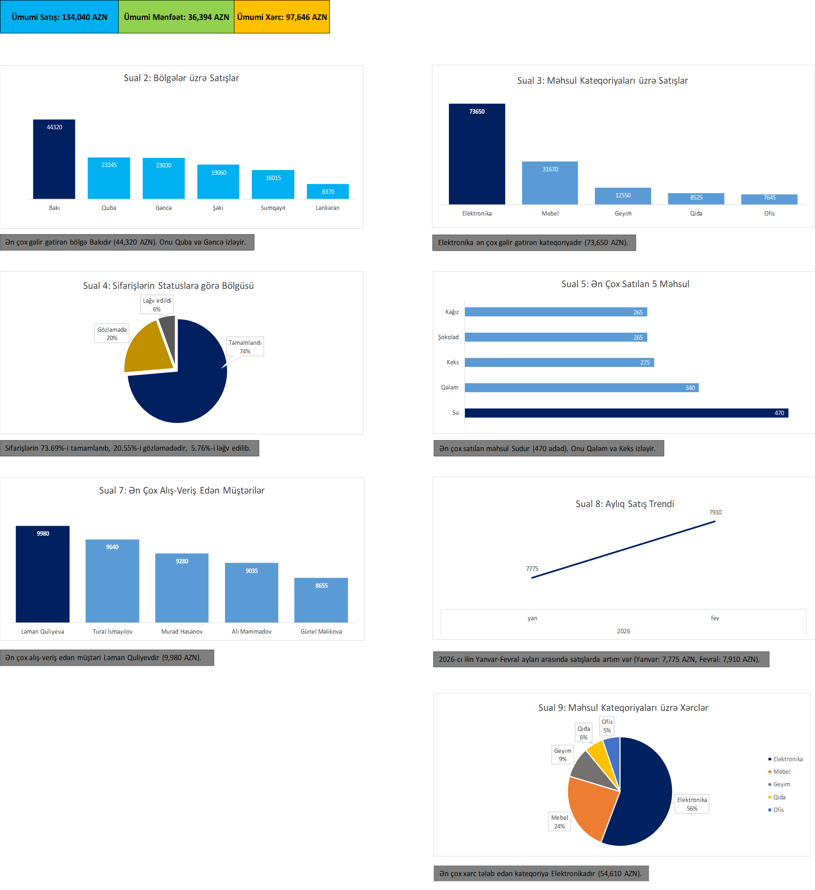

# Satış Məlumatlarının Analizi və Dashboard (Excel)

## Layihə Haqqında
Bu layihə 2026-cı ilin yanvarından 2027-ci ilin aprelinə qədər olan satış məlumatlarının təhlilini əhatə edir. Məqsəd xam məlumatı emal edərək biznes suallarına cavab tapmaq və nəticələri interaktiv Dashboard vasitəsilə vizuallaşdırmaqdır.

## İstifadə Olunan Alətlər
- **Microsoft Excel:** Əsas platforma
- **Power Query:** Məlumatların təmizlənməsi və yüklənməsi
- **Pivot Cədvəlləri:** Məlumatların qruplaşdırılması və analizi
- **Düsturlar:** SUMIF, SUMIFS, Calculated Field

## Layihənin Strukturu
- **Cover:** Layihənin üz qabığı və naviqasiya
- **Dashboard:** Vizual qrafiklər və əsas göstəricilər (KPI)
- **Insights:** 15 biznes sualına cavablar
- **Hesablamalar:** Bütün Pivot cədvəlləri və hesablamalar
- **Data:** Xam məlumat

## Əsas Nəticələr
- Ümumi Satış: 134,040 AZN
- Ümumi Mənfəət: 36,394 AZN
- Ən gəlirli bölgə: Bakı (44,320 AZN)
- Ən gəlirli kateqoriya: Elektronika (73,650 AZN)
- Ən yüksək mənfəət marjası: Lənkəran (29%)

## Dashboard Görünüşü
